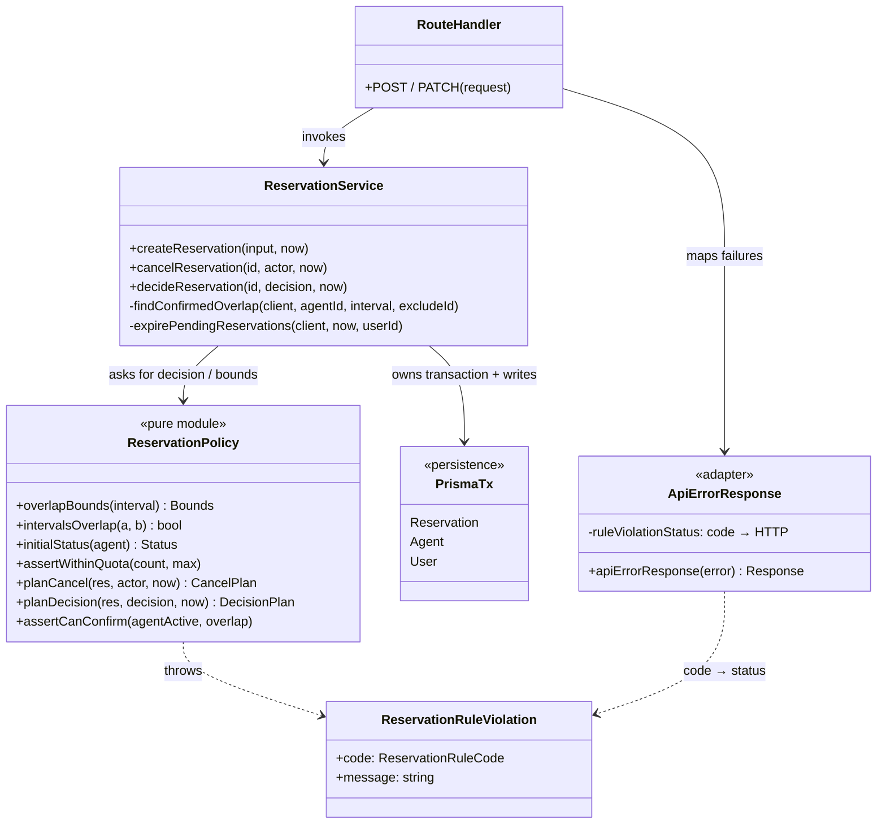
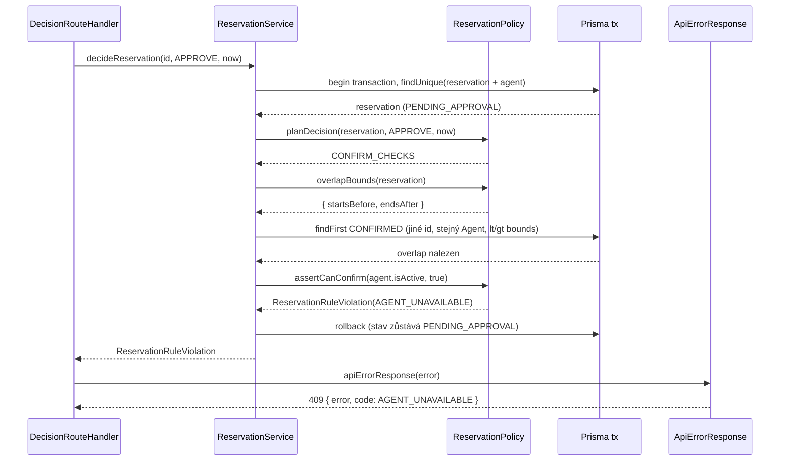

# C05 — Detailed Design

Vstup: architektura C03 ([architecture.md](../c03/architecture.md),
[ADR-001](../c03/adr/ADR-001-reservation-lifecycle-owner.md)) a specifikace v0.2
(`BR-01` až `BR-05`, `REQ-06` až `REQ-12`).

## 1. Vybraná architektonická jednotka

**Selected architecture unit / responsibility:** pravidla životního cyklu
Reservation uvnitř `Reservation Service` – rozhodování o vytvoření, zrušení,
schválení/zamítnutí a expiraci.

**Related requirement(s):** `REQ-06`, `REQ-07` (Create), `REQ-08` (Cancel),
`REQ-09` (podmínky Approve), `REQ-10` (souběh), `REQ-11` (Reject),
`REQ-12` (expirace) a změna OP-01 ve v0.2 (počáteční stav podle
`requiresApproval`, [specifikace](../specification.md) – Dopad změny, OP-01).

**Related scenario(s):** Create (OP-01), Cancel (OP-04), Approve/Reject včetně
konfliktu, který vznikl během čekání (OP-05, C03 sekvence H1).

**Relevant business rule(s):** `BR-01` (polootevřené intervaly), `BR-02`
(exkluzivita Agenta), `BR-03` (zrušení jen před `startTime`, idempotence),
`BR-04` (limit aktivních rezervací), `BR-05` (aktivní Agent).

**Důvod výběru:** po C03 refaktoru bylo rozhodování promíchané s Prisma voláními
v jedné funkci. Pravidla šlo ověřit jen přes běžící HTTP + databázi (C02 sada), ne
jako jednotky.

## 2. Detailní odpovědnosti

| Detailed responsibility | Why is it needed? |
|---|---|
| Definovat překryv dvou intervalů `[start, end)` | Jediná definice `BR-01`/`BR-02`; z ní se odvozuje jak kontrola v paměti, tak databázový dotaz pro Create, Availability i Approve. |
| Určit počáteční stav nové Reservation | Změna OP-01 ve v0.2: Agent s `requiresApproval` vede do `PENDING_APPROVAL`, jinak `CONFIRMED`. |
| Vynutit limit aktivních rezervací | `BR-04`: User nesmí překročit `maxReservations`. |
| Naplánovat výsledek zrušení | `REQ-08` + `BR-03` + `REQ-12`: oprávnění, idempotence, hranice `startTime`, expirace čekající žádosti. |
| Naplánovat výsledek rozhodnutí Admina | `REQ-09`/`REQ-11`/`REQ-12`: povolený zdrojový stav, expirace, Reject. |
| Ověřit podmínky potvrzení při Approve | `REQ-09`, `BR-02`/`BR-05`: Agent musí být aktivní a nesmí vzniknout překryv s `CONFIRMED`. |
| Pojmenovat důvod odmítnutí doménově | Pravidlo nesmí znát HTTP; adaptér rozhoduje o transportním kódu. |
| Provést čtení, zápis a transakci | Konzistence pod souběhem (`REQ-07`, `REQ-10`) – zůstává v service, ne v pravidlech. |

## 3. Struktura, data/state a vlastnictví

| Responsibility | Owner | State/data | Why here? |
|---|---|---|---|
| Překryv intervalů | `reservation-policy.overlapBounds` + `intervalsOverlap` | žádné (čisté funkce) | Testovatelné bez DB; jediná definice `BR-01`, kterou používá i dotaz v service. |
| Počáteční stav | `reservation-policy.initialStatus` | `Agent.requiresApproval` (vstup) | Variační bod v0.2 na jednom místě. |
| Limit rezervací | `reservation-policy.assertWithinQuota` | počet aktivních, `maxReservations` (vstupy) | Pravidlo oddělené od způsobu počítání. |
| Plán zrušení | `reservation-policy.planCancel` | `userId`, `status`, `startTime`, actor, `now` | Všechny větve `BR-03` v jedné funkci. |
| Plán rozhodnutí | `reservation-policy.planDecision` | `status`, `startTime`, rozhodnutí, `now` | Rozlišuje `EXPIRE` / `REJECT` / `CONFIRM_CHECKS`. |
| Podmínky potvrzení | `reservation-policy.assertCanConfirm` | `agent.isActive`, nález překryvu (vstupy) | Poslední kontrola před přechodem na `CONFIRMED`. |
| Překryv blokuje Create i Approve | `reservation-policy.assertNoConfirmedOverlap` | nález překryvu (vstup) | Jedno rozhodnutí `BR-02` pro obě cesty k `CONFIRMED` (v0.2.1). |
| Začátek v budoucnosti | `reservation-policy.assertStartsInFuture` | `startTime`, `now` | `BR-06` (v0.2.1): stejný zdroj času jako `BR-03`. |
| Důvod odmítnutí | `ReservationRuleViolation` (`code: ReservationRuleCode`) | `code`, `message` | Doménový kontrakt selhání bez HTTP. |
| Dotaz na překryv, expirace, zápisy, transakce, čas `now` | `reservation-service` (`findConfirmedOverlap`, `expirePendingReservations`) | Prisma `tx`, tabulka Reservation | Jediný zapisovatel (ADR-001); rozhoduje o I/O. |
| Mapování selhání na HTTP | `api-error-response.ts` (`ruleViolationStatus`) + Route Handlers | `code → status` | Adaptér; jediné místo, kde se doménový kód stává HTTP kódem. |
| Validace HTTP těla | `request-body.ts` (`readJsonObject`, `optionalString`, `parseInterval`) | JSON payload, query | Chybný payload nebo čas bez offsetu je 400 dřív, než dojde na service. |

**Směr závislostí:** `Route Handler → reservation-service → reservation-policy`,
`api-error-response → reservation-policy`. Policy **nemá žádný import** (hlídá
`npm run test:architecture`).

## 4. Rozhraní a kontrakty

### `ReservationPolicy` (modul `src/lib/reservation-policy.ts`)

Selhání pravidla je vždy `ReservationRuleViolation` s jedním z kódů:

| Kód | Význam | HTTP (adaptér) |
|---|---|---|
| `NOT_OWNER` | actor není vlastník ani ADMIN | 403 |
| `QUOTA_EXCEEDED` | `BR-04` by byl překročen | 403 |
| `INVALID_STATE` | zdrojový stav nepovoluje přechod | 409 |
| `AFTER_START` | `now >= startTime` | 409 |
| `START_IN_PAST` | `BR-06` – nová Reservation začíná v `now` nebo dříve | 400 |
| `AGENT_INACTIVE` | `BR-05` | 409 |
| `AGENT_UNAVAILABLE` | `BR-02` – existuje překrývající `CONFIRMED` | 409 |

```text
overlapBounds(interval) : { startsBefore, endsAfter }
  Postcondition:
    - existující interval E se překrývá s `interval`
      <=> E.startTime < startsBefore  a  E.endTime > endsAfter   (ostré nerovnosti, BR-01)
  Použití: intervalsOverlap (v paměti) i findConfirmedOverlap (Prisma lt/gt).

planCancel(reservation, actor, now) : CANCEL | ALREADY_CANCELLED | EXPIRE
  Preconditions:
    - reservation existuje (načtena service)
    - now je čas systémových hodin aplikace
  Postconditions:
    - ALREADY_CANCELLED  <=> status = CANCELLED (idempotence, bez změny stavu)
    - EXPIRE             <=> status = PENDING_APPROVAL a now >= startTime
    - CANCEL             <=> status ∈ {CONFIRMED, PENDING_APPROVAL} a now < startTime
  Failures:
    - NOT_OWNER      actor není vlastník ani ADMIN
    - INVALID_STATE  status ∈ {REJECTED, EXPIRED}
    - AFTER_START    CONFIRMED při now >= startTime

planDecision(reservation, decision, now) : EXPIRE | REJECT | CONFIRM_CHECKS
  Preconditions: reservation existuje
  Postconditions:
    - EXPIRE          <=> now >= startTime (platí i pro REJECT)
    - REJECT          <=> decision = REJECT a now < startTime
    - CONFIRM_CHECKS  <=> decision = APPROVE a now < startTime
  Failures:
    - INVALID_STATE  status ≠ PENDING_APPROVAL

assertCanConfirm(agentIsActive, hasConfirmedOverlap) : void
  Failures (v tomto pořadí):
    - AGENT_INACTIVE     Agent není aktivní
    - AGENT_UNAVAILABLE  existuje překrývající se CONFIRMED Reservation stejného Agenta

assertNoConfirmedOverlap(hasConfirmedOverlap, message?) : void
  Failures: AGENT_UNAVAILABLE pokud existuje překrývající se CONFIRMED (Create i Approve)

assertStartsInFuture(interval, now) : void
  Failures: START_IN_PAST pokud interval.startTime <= now   (BR-06)

assertWithinQuota(activeCount, maxReservations) : void
  Failures: QUOTA_EXCEEDED pokud activeCount >= maxReservations
```

Pomocné: `intervalsOverlap(a, b)`, `initialStatus(agent)`, `isPendingExpired(r, now)`.

## 5. Zaměřený strukturální pohled



Vlastnictví stavu: pouze `ReservationService` mění `Reservation.status`;
`ReservationPolicy` stav jen vyhodnocuje.

## 6. Detailní sekvence — Approve s konfliktem

C03 úroveň: `API → Reservation Service → Persistence`.
C05 úroveň uvnitř service:



## 7. Významné operace

| Operation | Responsibility | Input → Output | Preconditions | Postconditions | Side effects | Failure behavior |
|---|---|---|---|---|---|---|
| `createReservation` | vytvořit Reservation | `userId, agentId, interval, note` → Reservation | interval validován adaptérem (`start < end`, offset) | stav dle `initialStatus`; `BR-02`, `BR-04`, `BR-06` platí | expirace propadlých PENDING, insert | `START_IN_PAST`, 404 Agent, `AGENT_UNAVAILABLE`, 401 User, `QUOTA_EXCEEDED` |
| `cancelReservation` | zrušit nebo expirovat | `id, actor, now` → `{reservation, expired}` | Reservation existuje | stav dle `planCancel` | update `status` | 404, `NOT_OWNER`, `INVALID_STATE`, `AFTER_START` |
| `decideReservation` | Approve/Reject | `id, decision, now` → `{reservation, expired}` | Reservation existuje | stav dle `planDecision` + `assertCanConfirm` | update `status` | 404, `INVALID_STATE`, `AGENT_INACTIVE`, `AGENT_UNAVAILABLE` |
| `findConfirmedOverlap` | dotaz `BR-02` | `client, agentId, interval, excludeId?` → `{id} \| null` | – | výsledek odpovídá `intervalsOverlap` | čtení | – |
| `planCancel` / `planDecision` | čisté rozhodnutí | viz kontrakty | viz kontrakty | beze změny vstupů | žádné | `ReservationRuleViolation` |

Gettery, seznamové dotazy (`list*`) a `checkAgentAvailability` nejsou v DD
rozpracovány – nemají vlastní algoritmus nad rámec `BR-02` a sdílí
`findConfirmedOverlap`.

## 8. Algoritmus / rozhodovací logika

### Cancel (`planCancel`) — rozhodovací tabulka

| Pořadí | Podmínka | Výsledek |
|---|---|---|
| 1 | actor ≠ vlastník a role ≠ ADMIN | `NOT_OWNER` |
| 2 | `status = CANCELLED` | `ALREADY_CANCELLED` |
| 3 | `status = PENDING_APPROVAL` a `now >= startTime` | `EXPIRE` |
| 4 | `status ∉ {CONFIRMED, PENDING_APPROVAL}` | `INVALID_STATE` (terminální stav) |
| 5 | `now >= startTime` | `AFTER_START` |
| 6 | jinak | `CANCEL` |

### Decision (`planDecision` + `assertCanConfirm`)

```text
if status != PENDING_APPROVAL       -> INVALID_STATE
if now >= startTime                 -> EXPIRE          # i pro REJECT
if decision == REJECT               -> REJECT
# APPROVE:
if !agent.isActive                  -> AGENT_INACTIVE
if confirmedOverlap(agent, interval)-> AGENT_UNAVAILABLE   # overlapBounds → findConfirmedOverlap
-> CONFIRM
```

Pořadí kontrol je záměrné a zachovává chování ověřené C02 sadou.

## 9. Rozhodnutí záměrně ponechaná v kódu

- Konkrétní Prisma dotazy, `select`/`orderBy`, sestavení filtrů (hranice překryvu
  ale přichází z `overlapBounds`).
- Expirační `updateMany` (`expirePendingReservations`) – I/O; podmínka
  `startTime <= now` je hromadný ekvivalent `isPendingExpired`.
- Volba izolace transakce a retry při souběhu (viz zbývající riziko v evidenci).
- Text chybových zpráv a tvar HTTP odpovědi (`api-error-response.ts`).
- Neexistující/neaktivní Agent při Create (404) zůstává v service: karta OP-01
  záměrně nerozlišuje neznámého a neaktivního Agenta. Překryv při Create už
  rozhoduje policy (`assertNoConfirmedOverlap`, v0.2.1).

## 10. Testy odvozené z DD

Implementace: `scripts/c05-unit-tests.ts`, spuštění `npm run test:c05`
(bez databáze a bez běžící aplikace).

| DD element / decision | What must hold? | Test level | Test case |
|---|---|---|---|
| contract `intervalsOverlap` (`BR-01`) | dotyk hranic `[9,10)` a `[10,11)` není překryv | unit | `overlap: touching boundary …` |
| contract `overlapBounds` | hranice dotazu jsou ostré (`startsBefore = end`, `endsAfter = start`) | unit | `overlap: query bounds are strict …` |
| algorithm branch `planCancel` | cancel přesně v `startTime` je `AFTER_START`; před ním `CANCEL` | unit | `cancel: … exactly at startTime …` |
| state transition `PENDING → EXPIRED` | při `now >= startTime` vede Approve i Reject na `EXPIRE` | unit | `decision: at startTime pending expires …` |
| failure behavior `assertCanConfirm` | neaktivní Agent má přednost před překryvem; čistý stav projde | unit | `confirm: inactive agent and later overlap …` |
| failure behavior `assertWithinQuota` | při `count = max` je `QUOTA_EXCEEDED` | unit | `quota: below limit passes, at limit fails …` |
| idempotence `BR-03` | opakované zrušení nemění stav | unit | `cancel: repeated cancel is idempotent` |
| failure behavior `assertStartsInFuture` (`BR-06`) | začátek přesně v `now` i dříve je `START_IN_PAST` | unit | `future start: …` |
| contract `assertNoConfirmedOverlap` | Create i Approve hlásí `AGENT_UNAVAILABLE` | unit | `overlap rule: …` |
| collaboration service ↔ policy ↔ Prisma ↔ adaptér | konflikt vzniklý během čekání nepotvrdí Approve (409); souběžné Create/Approve; chybný payload → 400 | component/integration | C02 scénáře (`npm run test:c02`, vyžaduje běžící aplikaci) |

**Test: cancel na hranici `startTime`**
- Selected level: unit.
- Why this level: pravidlo je čistá funkce času; hranici `>=` nelze spolehlivě
  zasáhnout přes HTTP a systémové hodiny.
- Verified design decision: `BR-03`/`REQ-12` – `currentTime >= startTime` je
  jednotná hranice a rozhoduje o ní policy, ne handler.

**Test: konflikt při Approve (collaboration)**
- Selected level: component/integration.
- Why this level: překryv vzniká až čtením z databáze v transakci; ověřuje
  spolupráci service, policy, persistence a mapování `AGENT_UNAVAILABLE → 409`.
- Verified design decision: Approve znovu validuje `BR-02` v okamžiku rozhodnutí
  a při selhání ponechává stav `PENDING_APPROVAL` (rollback).

## 11. Design ↔ code

| DD decision | Implemented? | Evidence | Action |
|---|---|---|---|
| Pravidla jsou čisté funkce bez importů | YES | `src/lib/reservation-policy.ts`, `scripts/architecture-check.ts` | keep |
| Jediná definice překryvu pro paměť i dotaz | YES (po opravě) | `overlapBounds` → `findConfirmedOverlap` (Create, Availability, Approve) | původně NO – update code |
| Policy hlásí doménové kódy, ne HTTP | YES (po opravě) | `ReservationRuleViolation`, `api-error-response.ts` | původně `ApiError` s HTTP – update code |
| Service volá policy a zůstává jediným zapisovatelem | YES | `src/lib/reservation-service.ts`, architecture check | keep |
| Pořadí kontrol Cancel/Decision beze změny chování | YES | `npm run test:c02` 26/26 | keep |
| Testy odvozené z DD | YES | `scripts/c05-unit-tests.ts` (20 testů od v0.2.1) | keep |
| Testy spuštěny | YES | [evidence](../evidence-and-evolution.md#c05-dd-verification-evidence) | keep |
| Plán quota počítá v service, ne v policy | PARTLY | `createReservation` počítá `count` dotazem | keep – počítání je I/O, pravidlo je v policy |
| Překryv při Create rozhoduje policy | YES (v0.2.1) | `assertNoConfirmedOverlap` v `createReservation` | původně `ApiError` 409 v service – update code |
| `BR-06` začátek v budoucnosti | YES (v0.2.1) | `assertStartsInFuture`, unit + C02 test | nové pravidlo z code review |
| `BR-05` při Create v policy | NO (vědomě) | `createReservation` (404) | keep – viz §9 |
