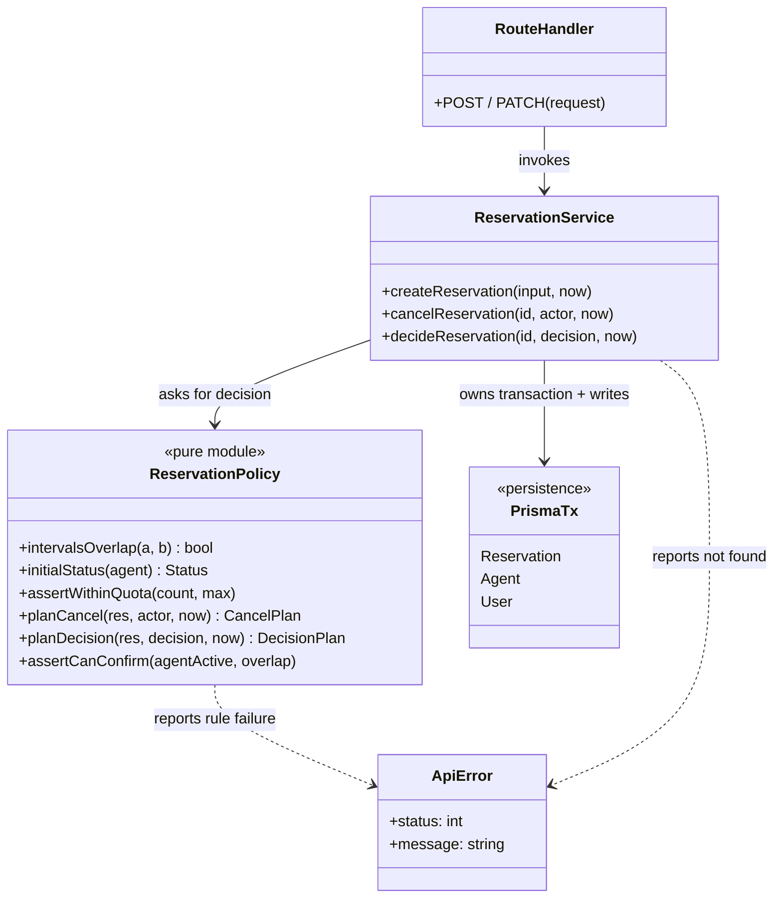
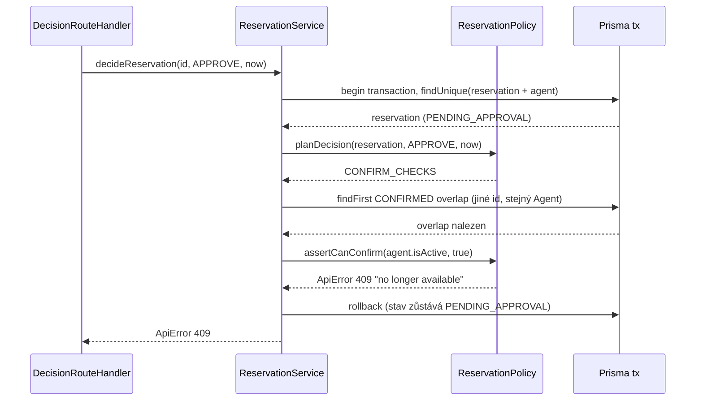

# C05 — Detailed Design

Vstup: architektura C03 ([architecture.md](../c03/architecture.md),
[ADR-001](../c03/adr/ADR-001-reservation-lifecycle-owner.md)) a specifikace v0.2
(`BR-01` až `BR-05`, `REQ-06` až `REQ-12`).

## 1. Vybraná architektonická jednotka

**Selected architecture unit / responsibility:** pravidla životního cyklu
Reservation uvnitř `Reservation Service` – rozhodování o vytvoření, zrušení,
schválení/zamítnutí a expiraci.

**Related requirement(s):** `REQ-06`, `REQ-07`, `REQ-08`, `REQ-09`, `REQ-10`,
`REQ-11`, `REQ-12`.

**Related scenario(s):** Create (OP-01), Cancel (OP-04), Approve/Reject včetně
konfliktu, který vznikl během čekání (OP-05, C03 sekvence H1).

**Relevant business rule(s):** `BR-01` (polootevřené intervaly), `BR-02`
(exkluzivita Agenta), `BR-03` (zrušení jen před `startTime`, idempotence),
`BR-04` (limit aktivních rezervací), `BR-05` (aktivní Agent).

**Důvod výběru:** po C03 refaktoru bylo rozhodování promíchané s Prisma voláními
v jedné funkci. Pravidla šlo ověřit jen přes běžící HTTP + databázi (C02 sada), ne
jako jednotky.

## 2. Detailní odpovědnosti

| Detailed responsibility | Why is it needed? |
|---|---|
| Vyhodnotit překryv dvou intervalů `[start, end)` | Jediná definice `BR-01`/`BR-02` pro Create, Availability i Approve. |
| Určit počáteční stav nové Reservation | `REQ-09`: Agent s `requiresApproval` vede do `PENDING_APPROVAL`, jinak `CONFIRMED`. |
| Vynutit limit aktivních rezervací | `BR-04`: User nesmí překročit `maxReservations`. |
| Naplánovat výsledek zrušení | `BR-03` + `REQ-12`: oprávnění, idempotence, hranice `startTime`, expirace čekající žádosti. |
| Naplánovat výsledek rozhodnutí Admina | `REQ-10`/`REQ-11`/`REQ-12`: povolený zdrojový stav, expirace, Reject. |
| Ověřit podmínky potvrzení při Approve | `BR-02`/`BR-05`: Agent musí být aktivní a nesmí vzniknout překryv s `CONFIRMED`. |
| Provést čtení, zápis a transakci | Konzistence pod souběhem (`REQ-10`) – zůstává v service, ne v pravidlech. |

## 3. Struktura, data/state a vlastnictví

| Responsibility | Owner | State/data | Why here? |
|---|---|---|---|
| Překryv intervalů | `reservation-policy.intervalsOverlap` | žádné (čistá funkce) | Testovatelné bez DB; sdílená definice `BR-01`. |
| Počáteční stav | `reservation-policy.initialStatus` | `Agent.requiresApproval` (vstup) | Variační bod `REQ-09` na jednom místě. |
| Limit rezervací | `reservation-policy.assertWithinQuota` | počet aktivních, `maxReservations` (vstupy) | Pravidlo oddělené od způsobu počítání. |
| Plán zrušení | `reservation-policy.planCancel` | `userId`, `status`, `startTime`, actor, `now` | Všechny větve `BR-03` v jedné funkci. |
| Plán rozhodnutí | `reservation-policy.planDecision` | `status`, `startTime`, rozhodnutí, `now` | Rozlišuje `EXPIRE` / `REJECT` / `CONFIRM_CHECKS`. |
| Podmínky potvrzení | `reservation-policy.assertCanConfirm` | `agent.isActive`, nález překryvu (vstupy) | Poslední kontrola před přechodem na `CONFIRMED`. |
| Dotazy, zápisy, transakce, čas `now` | `reservation-service` | Prisma `tx`, tabulka Reservation | Jediný zapisovatel (ADR-001); rozhoduje o I/O. |
| Mapování selhání na HTTP | `ApiError` + Route Handlers | `status`, `message` | Beze změny od C03. |

**Směr závislostí:** `Route Handler → reservation-service → reservation-policy`.
Policy nesmí importovat Prisma ani service (hlídá `npm run test:architecture`).

## 4. Rozhraní a kontrakty

### `ReservationPolicy` (modul `src/lib/reservation-policy.ts`)

```text
planCancel(reservation, actor, now) : CANCEL | ALREADY_CANCELLED | EXPIRE
  Preconditions:
    - reservation existuje (načtena service)
    - now je čas systémových hodin aplikace
  Postconditions:
    - ALREADY_CANCELLED  <=> status = CANCELLED (idempotence, bez změny stavu)
    - EXPIRE             <=> status = PENDING_APPROVAL a now >= startTime
    - CANCEL             <=> status ∈ {CONFIRMED, PENDING_APPROVAL} a now < startTime
  Failures (ApiError):
    - 403  actor není vlastník ani ADMIN
    - 409  status ∈ {REJECTED, EXPIRED} nebo CONFIRMED při now >= startTime

planDecision(reservation, decision, now) : EXPIRE | REJECT | CONFIRM_CHECKS
  Preconditions: reservation existuje
  Postconditions:
    - EXPIRE          <=> now >= startTime (platí i pro REJECT)
    - REJECT          <=> decision = REJECT a now < startTime
    - CONFIRM_CHECKS  <=> decision = APPROVE a now < startTime
  Failures:
    - 409  status ≠ PENDING_APPROVAL

assertCanConfirm(agentIsActive, hasConfirmedOverlap) : void
  Failures:
    - 409  Agent není aktivní (kontrola první)
    - 409  existuje překrývající se CONFIRMED Reservation stejného Agenta

assertWithinQuota(activeCount, maxReservations) : void
  Failures: 403 pokud activeCount >= maxReservations
```

Pomocné: `intervalsOverlap(a, b)`, `initialStatus(agent)`, `isPendingExpired(r, now)`.

## 5. Zaměřený strukturální pohled



Vlastnictví stavu: pouze `ReservationService` mění `Reservation.status`;
`ReservationPolicy` stav jen vyhodnocuje.

## 6. Detailní sekvence — Approve s konfliktem

C03 úroveň: `API → Reservation Service → Persistence`.
C05 úroveň uvnitř service:



## 7. Významné operace

| Operation | Responsibility | Input → Output | Preconditions | Postconditions | Side effects | Failure behavior |
|---|---|---|---|---|---|---|
| `createReservation` | vytvořit Reservation | `userId, agentId, interval, note` → Reservation | Agent existuje a je aktivní; User existuje | stav dle `initialStatus`; `BR-02`, `BR-04` platí | expirace propadlých PENDING, insert | 404 Agent, 409 překryv, 401 User, 403 limit |
| `cancelReservation` | zrušit nebo expirovat | `id, actor, now` → `{reservation, expired}` | Reservation existuje | stav dle `planCancel` | update `status` | 404, 403, 409 |
| `decideReservation` | Approve/Reject | `id, decision, now` → `{reservation, expired}` | Reservation existuje | stav dle `planDecision` + `assertCanConfirm` | update `status` | 404, 409 |
| `planCancel` / `planDecision` | čisté rozhodnutí | viz kontrakty | viz kontrakty | beze změny vstupů | žádné | `ApiError` |

Gettery, seznamové dotazy (`list*`) a `checkAgentAvailability` nejsou v DD
rozpracovány – nemají vlastní algoritmus nad rámec `BR-02`.

## 8. Algoritmus / rozhodovací logika

### Cancel (`planCancel`) — rozhodovací tabulka

| Pořadí | Podmínka | Výsledek |
|---|---|---|
| 1 | actor ≠ vlastník a role ≠ ADMIN | 403 |
| 2 | `status = CANCELLED` | `ALREADY_CANCELLED` |
| 3 | `status = PENDING_APPROVAL` a `now >= startTime` | `EXPIRE` |
| 4 | `status ∉ {CONFIRMED, PENDING_APPROVAL}` | 409 (terminální stav) |
| 5 | `now >= startTime` | 409 (po začátku) |
| 6 | jinak | `CANCEL` |

### Decision (`planDecision` + `assertCanConfirm`)

```text
if status != PENDING_APPROVAL       -> 409
if now >= startTime                 -> EXPIRE          # i pro REJECT
if decision == REJECT               -> REJECT
# APPROVE:
if !agent.isActive                  -> 409
if confirmedOverlap(agent, interval)-> 409
-> CONFIRM
```

Pořadí kontrol je záměrné a zachovává chování ověřené C02 sadou.

## 9. Rozhodnutí záměrně ponechaná v kódu

- Konkrétní Prisma dotazy, `select`/`orderBy`, sestavení filtrů.
- Expirační `updateMany` při čtení (`expirePendingReservations`) – I/O, ne pravidlo.
- Volba izolace transakce a retry při souběhu (viz zbývající riziko v evidenci).
- Zpráva a tvar HTTP odpovědi (`api-error-response.ts`).

## 10. Testy odvozené z DD

Implementace: `scripts/c05-unit-tests.ts`, spuštění `npm run test:c05`
(bez databáze a bez běžící aplikace).

| DD element / decision | What must hold? | Test level | Test case |
|---|---|---|---|
| contract `intervalsOverlap` (`BR-01`) | dotyk hranic `[9,10)` a `[10,11)` není překryv | unit | `overlap: touching boundary …` |
| algorithm branch `planCancel` | cancel přesně v `startTime` je 409; před ním `CANCEL` | unit | `cancel: … exactly at startTime …` |
| state transition `PENDING → EXPIRED` | při `now >= startTime` vede Approve i Reject na `EXPIRE` | unit | `decision: at startTime pending expires …` |
| failure behavior `assertCanConfirm` | neaktivní Agent a pozdější překryv dávají 409, čistý stav projde | unit | `confirm: inactive agent and later overlap …` |
| failure behavior `assertWithinQuota` | při `count = max` je 403 | unit | `quota: below limit passes, at limit fails …` |
| idempotence `BR-03` | opakované zrušení nemění stav | unit | `cancel: repeated cancel is idempotent` |
| collaboration service ↔ policy ↔ Prisma | konflikt vzniklý během čekání nepotvrdí Approve; souběžné Create/Approve | component/integration | existující scénáře C02 (`npm run test:c02`, vyžaduje běžící aplikaci) |

**Test: cancel na hranici `startTime`**
- Selected level: unit.
- Why this level: pravidlo je čistá funkce času; hranici `>=` nelze spolehlivě
  zasáhnout přes HTTP a systémové hodiny.
- Verified design decision: `BR-03`/`REQ-12` – `currentTime >= startTime` je
  jednotná hranice a rozhoduje o ní policy, ne handler.

**Test: konflikt při Approve (collaboration)**
- Selected level: component/integration.
- Why this level: překryv vzniká až čtením z databáze v transakci; ověřuje
  spolupráci service, policy a persistence.
- Verified design decision: Approve znovu validuje `BR-02` v okamžiku rozhodnutí
  a při selhání ponechává stav `PENDING_APPROVAL` (rollback).

## 11. Design ↔ code

| DD decision | Implemented? | Evidence | Action |
|---|---|---|---|
| Pravidla jsou čisté funkce bez Prisma | YES | `src/lib/reservation-policy.ts`, kontrola v `scripts/architecture-check.ts` | keep |
| Service volá policy a zůstává jediným zapisovatelem | YES | `src/lib/reservation-service.ts` | keep |
| Pořadí kontrol Cancel/Decision beze změny chování | YES | porovnání s C03 verzí; C02 sada | keep |
| Testy odvozené z DD | YES | `scripts/c05-unit-tests.ts` | keep |
| Testy spuštěny | NO | viz [evidence](../evidence-and-evolution.md) | spustit `npm run test:c05` |
| Plán quota počítá v service, ne v policy | PARTLY | `createReservation` počítá `count` dotazem | keep – počítání je I/O, pravidlo je v policy |
