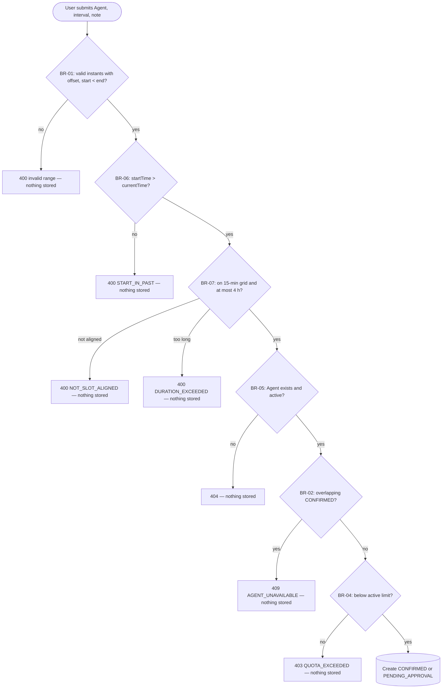

# Reservation System — Specification

> **Accepted modeling decision:** A create request is validated immediately.
> If all rules pass, the Reservation is stored
> directly as `CONFIRMED`. If validation fails, no Reservation is created.
>
> In baseline v0.1, **Confirm Reservation is the system's atomic commit decision
> inside Create Reservation**, not a separate User action or a transition from a stored
> pre-confirmation state.
> This decision is used consistently throughout the specification and diagrams.

# Specification Baseline v0.1

## Domain

The system allows Users to reserve compute time of a concrete AI Agent.

Each AI Agent is treated as an exclusive Resource in baseline v0.1:
at one moment, its compute time may be allocated by at most one overlapping
`CONFIRMED` Reservation.

---

# Domain rules

## AR-01 — Identity and access

A User registers with a name, unique email address and password, then authenticates
before creating or cancelling their own Reservations. The system derives the actor
from the active server-side Session; an email supplied as ordinary request data is
not accepted as proof of identity.

Only a User with role `ADMIN` may open the administrative Reservation view or perform
OP-05. The public Gantt overview remains readable without authentication and does not
expose User identity or free-text notes.

Passwords are stored only as salted hashes. A Session is represented in the browser
by an `HttpOnly`, `SameSite=Lax` cookie and can be explicitly terminated by logout.

## BR-01 — Interval semantics

Reservation intervals use half-open semantics:

`[startTime, endTime)`

and must satisfy:

`startTime < endTime`

Therefore `[10:00,11:00)` and `[11:00,12:00)` do not overlap.

*(v0.2.1)* `startTime` and `endTime` are instants in ISO 8601 with an explicit
offset or `Z` (e.g. `2035-01-15T10:00:00Z`). A value without an offset is invalid
input, because its meaning would depend on the server's time zone.

## BR-02 — Exclusive Agent invariant

At no committed system state may two `CONFIRMED` Reservations overlap
for the same AI Agent.

Two intervals overlap exactly when:

`existing.startTime < requested.endTime`
and
`existing.endTime > requested.startTime`

## BR-03 — Cancellation policy

A `CONFIRMED` Reservation can be cancelled only before its `startTime`.

If:

`currentTime < startTime`

the Reservation may transition to `CANCELLED`.

If:

`currentTime >= startTime`

cancellation is rejected.

Repeated cancellation of an already `CANCELLED` Reservation is idempotent:
the operation succeeds without another state change.

The source of `currentTime` is the reservation application's system clock.

## BR-04 — Maximum active reservations

A User may have at most `N` active Reservations.

In baseline v0.1, an active Reservation means a `CONFIRMED` Reservation
whose `endTime` has not yet passed.

`CANCELLED` Reservations do not count toward the limit.

`N` is configurable.

Concurrent requests must not allow a User to exceed `N`.

## BR-05 — Active Agent

Only an active AI Agent may receive a new `CONFIRMED` Reservation.

If the Agent is inactive, creation is rejected and no Reservation is created.

## BR-06 — Future start *(v0.2.1)*

A new Reservation must satisfy `currentTime < startTime`, with `currentTime`
read from the reservation application's system clock (as in BR-03).

Rationale: a Reservation starting in the past could never be cancelled (BR-03)
and, for approval-required Agents, would be created only to expire (REQ-12).
Existing Reservations are not affected.

## BR-07 — Slot granularity and maximum duration *(v0.3, CR-08)*

A new Reservation must satisfy both conditions:

- `startTime` and `endTime` lie on the 15-minute slot grid in UTC: minutes are
  0, 15, 30 or 45 and seconds and milliseconds are 0
  (`epochMilliseconds mod 900000 = 0`);
- `endTime - startTime <= 4 hours`; exactly 4 hours is allowed.

Together with BR-01 (`startTime < endTime`), the shortest Reservation is 15 minutes.
Alignment is evaluated on the instant, so an instant with any real-world offset
(all are multiples of 15 minutes, e.g. `+01:00`, `+05:30`, `+05:45`) is aligned
in UTC exactly when it is aligned in its own local time.

BR-07 is evaluated by Create only, after BR-01 and BR-06 and before BR-05, BR-02
and BR-04. Reservations stored before v0.3 are not affected: they are not
re-validated by Cancel or Approve and keep blocking their Agent under BR-02.
Availability (OP-02) is a read-only query and still accepts any BR-01 interval.

Rationale: BR-04 limits the number of active Reservations, not their length;
without a maximum duration one User can block an exclusive Agent for days.
Arbitrary instants fragment an Agent's schedule into unusable gaps
(CR-08, [intent-and-change.md](intent-and-change.md#c08--cr-08--controlled-change-card)).

---

# OP-01 — Create Reservation

## Goal / user value

A User reserves compute time of an AI Agent in one operation.

## Trigger

A User submits an Agent, time interval and optional note.

## Observable requirements

**REQ-01:**  
For an existing active Agent and valid interval, the system shall create
a Reservation only if all confirmation rules are satisfied.

**REQ-02:**  
A successfully created Reservation shall be stored directly as `CONFIRMED`.

**REQ-03:**  
If any validation or business rule fails, no Reservation shall be created.

**REQ-04:**  
The system shall not create a Reservation if doing so would exceed BR-04.

**REQ-13** *(v0.3, CR-08)*:  
The system shall not create a Reservation whose interval violates BR-07; such a
request is rejected as invalid input and no Reservation is created.

## Preconditions

- User is identified by an authenticated Session.
- Agent exists.
- Agent is active.
- `startTime < endTime`.
- User remains within the active Reservation limit.
- requested interval does not overlap another `CONFIRMED` Reservation
  of the same Agent.

## Success postcondition

- exactly one new Reservation exists;
- `Reservation.state = CONFIRMED`;
- the Reservation has a User and Agent;
- the returned Reservation ID equals the persisted Reservation ID;
- the interval now blocks the Agent.

## State change

`[none] → CONFIRMED`

## Referenced rules

BR-01, BR-02, BR-04, BR-05; *(v0.2.1)* BR-06; *(v0.3)* BR-07.

## Main success scenario

1. Authenticated User submits Agent, interval and optional note.
2. System validates required input.
3. System validates the interval.
4. System verifies that the Agent exists and is active.
5. System checks for an overlapping `CONFIRMED` Reservation.
6. System verifies the User's active Reservation limit.
7. System creates the Reservation as `CONFIRMED`.
8. System returns the Reservation identifier, Agent identifier and state.

## Alternative / failure outcomes

- unknown or inactive Agent → reject; no Reservation created;
- invalid interval → reject; no Reservation created;
- *(v0.2.1)* `startTime <= currentTime` (BR-06) → reject; no Reservation created;
- *(v0.2.1)* note longer than 500 characters → reject; no Reservation created;
- *(v0.3)* interval not on the 15-minute grid or longer than 4 hours (BR-07) →
  reject as invalid input; no Reservation created;
- overlapping `CONFIRMED` Reservation → reject; no Reservation created;
- active Reservation limit exceeded → reject; no Reservation created;
- persistence failure → no successful result is reported.

## Verification examples

- active Agent + free `[10:00,11:00)` → one `CONFIRMED` Reservation is created;
- `startTime == endTime` → rejected;
- *(v0.2.1)* `startTime` one hour before `currentTime` → rejected;
- *(v0.2.1)* `startTime` without offset (`2035-01-15T10:00:00`) → rejected;
- *(v0.3)* `[10:00,14:00)` (exactly 4 hours) → created;
- *(v0.3)* `[10:07,10:52)`, `[10:00:30,11:00)` or `[10:00,14:15)` → rejected;
- inactive Agent → rejected;
- overlap with an existing `CONFIRMED` Reservation → rejected;
- User already has `N` active Reservations → rejected.

## Rationale

The current system has no persisted intermediate state. Validation and confirmation
are performed before the Reservation is committed.

---

# OP-02 — Check Availability

## Goal / user value

A User can determine whether an AI Agent is available for a requested interval.

## Trigger

A User requests availability for an Agent and interval.

## Observable requirement

**REQ-05:**  
For a valid interval, the system reports an active Agent as `UNAVAILABLE`
if the interval overlaps any `CONFIRMED` Reservation of that Agent;
otherwise it reports `AVAILABLE`.

An inactive Agent is `UNAVAILABLE`.

## Preconditions

- Agent exists.
- `startTime < endTime`.

## Success postcondition

- availability result is returned;
- no Reservation state is changed.

## State change

None.

## Referenced rules

BR-01, BR-02, BR-05.

## Main success scenario

1. User supplies Agent and interval.
2. System validates the interval.
3. System checks whether the Agent is active.
4. System checks overlap with `CONFIRMED` Reservations.
5. System returns `AVAILABLE` or `UNAVAILABLE`.

## Alternative / failure outcomes

- unknown Agent → reject;
- invalid interval → reject;
- inactive Agent → `UNAVAILABLE`.

## Verification examples

Existing `CONFIRMED`: `[10:00,11:00)`

- `[09:00,10:00)` → `AVAILABLE`
- `[10:30,11:30)` → `UNAVAILABLE`
- `[11:00,12:00)` → `AVAILABLE`

---

# OP-03 — Confirm Reservation

## Goal / user value

The system atomically accepts a valid Create request as a committed allocation
of the Agent, without asking the User or an Admin for another action.

## Trigger

OP-01 reaches its final commit decision after all Create input has been validated.

## Accepted baseline semantics

Baseline v0.1 does not expose a separate confirmation action or a persisted
pre-confirmation state.

Confirmation is performed **inside the Create Reservation transaction**.
A create request either:

- passes all confirmation checks and is stored as `CONFIRMED`; or
- fails and creates no Reservation.

Therefore OP-03 is an explicit system decision required by the assignment, but not
a separate User goal, API call, use case or transition from another persisted state
in v0.1.

## Preconditions

- the Create request identifies an existing active Agent;
- `startTime < endTime`;
- the interval does not overlap another `CONFIRMED` Reservation of the Agent;
- the User remains within the active Reservation limit.

## Observable requirements

**REQ-06:**  
A Reservation may become committed only when:

- the Agent is active;
- the interval is valid;
- no overlapping `CONFIRMED` Reservation exists for the same Agent;
- the User does not exceed BR-04.

**REQ-07:**  
For concurrent conflicting create/confirm attempts, at most one Reservation
may be committed as `CONFIRMED`.

## State change

`[none] → CONFIRMED` as the final atomic step of OP-01.

No separate confirmation state or second User request exists.

## Referenced rules

BR-01, BR-02, BR-04, BR-05.

## Main success scenario

1. OP-01 validates the request and domain rules.
2. The system atomically persists one Reservation as `CONFIRMED`.
3. The same OP-01 response returns its identifier and state.

## Success postcondition

- exactly one persisted Reservation is `CONFIRMED`;
- the Reservation blocks the Agent for its interval;
- BR-02 remains true.

## Failure outcomes

- inactive Agent → no Reservation created;
- overlap exists → no Reservation created;
- invalid interval → no Reservation created;
- User limit exceeded → no Reservation created;
- concurrent conflict → at most one request succeeds.

## Verification examples

- valid create + active Agent + no overlap → `CONFIRMED`;
- overlapping create → rejected, no second Reservation created;
- two concurrent conflicting requests → at most one `CONFIRMED`.

## Rationale

The current API performs confirmation checks immediately during creation,
so introducing an artificial stored intermediate state would not describe
the actual accepted system behavior.

---

# OP-04 — Cancel Reservation

## Goal / user value

A User can withdraw an existing Reservation and release the Agent's interval.

## Trigger

A User requests cancellation of an existing Reservation.

## Observable requirement

**REQ-08:**  
A `CONFIRMED` Reservation can transition to `CANCELLED`
when `currentTime < startTime`.

## Preconditions

- Reservation exists.
- actor is authenticated and is its owner or an Admin.
- Reservation is `CONFIRMED` or already `CANCELLED`.

## Success postcondition

- `Reservation.state = CANCELLED`;
- the Reservation no longer blocks Agent availability.

## State change

`CONFIRMED → CANCELLED`

Repeated cancel:

`CANCELLED → CANCELLED`

## Referenced rules

BR-02, BR-03.

## Main success scenario

1. User requests cancellation.
2. System loads Reservation.
3. System verifies the Session and ownership / Admin authorization.
4. System checks the state and time boundary.
5. System changes the state to `CANCELLED`.
6. System returns the current state.

## Alternative / failure outcomes

- Reservation does not exist → reject;
- unauthorized User → reject;
- `currentTime >= startTime` → reject;
- already `CANCELLED` → idempotent success.

## Verification examples

- `CONFIRMED` before start → `CANCELLED`;
- `CONFIRMED` exactly at start → rejected;
- already `CANCELLED` → success without another state change.

---

# Requirement acceptance review

## REQ-01 to REQ-04 — Create

- Meaning: creation includes immediate validation and commitment.
- Need: describes the current one-step reservation flow.
- Observable result: either one `CONFIRMED` Reservation exists or none exists.
- Feasibility: consistent with current persistence model.
- Verification: API response and persisted record can be compared by ID and values.
- State/time: interval boundaries and current active Reservations matter.
- Concurrency: simultaneous conflicting creates must not both succeed.
- Consistency: same overlap rule is used by Availability and confirmation checks.
- Uncertainty: no stored intermediate state is assumed.

## REQ-05 — Availability

- Meaning: only `CONFIRMED` Reservations block the Agent.
- Need: lets Users inspect availability before attempting creation.
- Observable result: `AVAILABLE` / `UNAVAILABLE`.
- Verification: boundary interval examples.
- State/time: uses `[start,end)`.
- Concurrency: result is a snapshot and may change before a later Create.
- Consistency: uses BR-02.
- Uncertainty: none.

## REQ-06 / REQ-07 — Confirm

- Meaning: confirmation is the commit decision inside Create.
- Need: separates the business meaning of allocation from merely receiving input.
- Observable result: successful Create produces `CONFIRMED`.
- Verification: successful create, conflict rejection, concurrency case.
- State/time: depends on Agent state and interval.
- Concurrency: at most one conflicting request is committed.
- Consistency: uses the same rules as Create and Availability.
- Uncertainty: none in v0.1.

## REQ-08 — Cancel

- Meaning: cancellation changes state; it does not physically delete history.
- Need: releases future reserved compute time while preserving the record.
- Observable result: `CANCELLED`.
- Verification: before start succeeds; at/after start fails.
- State/time: depends on `currentTime < startTime`.
- Concurrency: final state must remain consistent if cancellation races with another operation.
- Consistency: `CANCELLED` does not block availability.
- Uncertainty: none.

---

# Specification Baseline v0.1 — team approval

Status: [ ] Approved by team

Approved by:
- ...
- ...
- ...

Date:
...

---

# C02 change impact — Approval process

## Changed condition

Some AI Agents require a decision by an authorized Admin before a Reservation
can become `CONFIRMED`. Agent therefore gains the property `requiresApproval`.

## Accepted expiration policy

Approval is possible only before the reserved interval begins. For a
`PENDING_APPROVAL` Reservation:

- `currentTime < startTime` → Admin may approve or reject;
- `currentTime >= startTime` → the Reservation is `EXPIRED` and cannot be approved.

The reservation application's system clock is the source of `currentTime`.
The transition to `EXPIRED` must be applied no later than the next read or decision
concerning that Reservation. This avoids inventing an arbitrary approval timeout.

## Impact analysis before implementation

| Area | Accepted impact in baseline v0.2 |
|---|---|
| Create | The same rules are checked immediately. A valid request becomes `CONFIRMED` when approval is not required, otherwise `PENDING_APPROVAL`. |
| Availability | Only `CONFIRMED` blocks the Agent. `PENDING_APPROVAL` is visible but does not block availability. |
| Confirm | For an Agent without approval it remains the atomic commit inside Create. For an approval-required Agent it occurs only through successful OP-05. |
| Approve / Reject | New Admin goal and operation OP-05. Availability and Agent activity are checked again at approval time. |
| Cancel | A future `PENDING_APPROVAL` Reservation may be cancelled under the same time boundary as `CONFIRMED`. |
| Agent administration | UC5 gains the ability to set `requiresApproval`. |
| State model | Adds `PENDING_APPROVAL`, `REJECTED` and `EXPIRED`. |
| User limit | `PENDING_APPROVAL` and future `CONFIRMED` Reservations count toward the limit. |

## Explicitly unaffected parts

- BR-01 interval semantics remain `[startTime,endTime)` because approval does not
  change the reserved interval.
- BR-02 remains unchanged: only `CONFIRMED` Reservations are committed allocations.
- UC1 remains a read-only Gantt overview of all Reservations.
- UC4 continues to edit future `CONFIRMED` Reservations only; editing an approval
  request is not introduced by this change.
- UC6 remains the general administrative overview; the decision itself is UC8 / OP-05.
- For `requiresApproval = false`, the complete v0.1 Create behavior is unchanged.

## Baseline v0.2 deltas for existing operations

### OP-01 — Create Reservation

- common validation: valid interval, existing active Agent, no current overlap and
  User below the active Reservation limit;
- `requiresApproval = false` → `[none] → CONFIRMED`;
- `requiresApproval = true` → `[none] → PENDING_APPROVAL`;
- failure of any common validation rule → no Reservation is created.

### OP-02 — Check Availability

`PENDING_APPROVAL` does not block availability. Only an overlapping `CONFIRMED`
Reservation makes the Agent unavailable. The result remains a snapshot and may
change before a later approval decision.

### OP-03 — Confirm Reservation

- without approval: `[none] → CONFIRMED` inside successful Create;
- with approval: `PENDING_APPROVAL → CONFIRMED` only through OP-05.

No separate confirmation request by the User is introduced.

### OP-04 — Cancel Reservation

REQ-08 is extended to allow cancellation of `CONFIRMED` or `PENDING_APPROVAL`
when `currentTime < startTime`. Both transition to `CANCELLED` and no longer affect
availability or the active Reservation limit.

---

# OP-05 — Approve / Reject Reservation

## Goal / user value

An authorized Admin decides a Reservation waiting for approval so it is either
committed, rejected, or recognized as expired.

## Trigger

An authorized Admin requests approval or rejection of a `PENDING_APPROVAL`
Reservation.

## Observable requirements

**REQ-09:**
The system shall approve a `PENDING_APPROVAL` Reservation only when
`currentTime < startTime`, the Agent is active, and its interval does not overlap
another `CONFIRMED` Reservation of the same Agent.

**REQ-10:**
For concurrent Create or Approve operations that conflict under BR-02, at most
one Reservation shall reach `CONFIRMED`.

**REQ-11:**
An authorized Admin may reject a non-expired `PENDING_APPROVAL` Reservation;
the Reservation shall become `REJECTED`.

**REQ-12:**
At `currentTime >= startTime`, a `PENDING_APPROVAL` Reservation shall be treated
as `EXPIRED`, shall not be approved, and the state shall be persisted no later than
its next read or decision.

## Preconditions

- Reservation exists;
- actor has an authenticated Session with role `ADMIN`;
- Reservation is `PENDING_APPROVAL` when the decision begins.

## Success postcondition — approval

- `Reservation.state = CONFIRMED`;
- the Reservation blocks its Agent for its interval;
- BR-02 remains true.

## Success postcondition — rejection

- `Reservation.state = REJECTED`;
- the Reservation does not block its Agent and does not count toward BR-04.

## State changes

- approval: `PENDING_APPROVAL → CONFIRMED`;
- rejection: `PENDING_APPROVAL → REJECTED`;
- expiration: `PENDING_APPROVAL → EXPIRED`.

## Referenced rules

BR-01, BR-02, BR-03, BR-04 and BR-05.

## Main success scenario — approval

1. Admin requests approval of a `PENDING_APPROVAL` Reservation.
2. System verifies the Admin Session and role.
3. System reads `currentTime` once and verifies `currentTime < startTime`.
4. System verifies that the Agent is active.
5. System rechecks overlap with `CONFIRMED` Reservations.
6. System atomically changes the Reservation to `CONFIRMED`.
7. System returns the Reservation identifier and current state.

## Alternative / failure outcomes

- unauthorized actor → reject; state unchanged;
- unknown Reservation → reject;
- invalid source state → reject; state unchanged;
- Admin rejects before expiration → `REJECTED`;
- `currentTime >= startTime` → `EXPIRED`; approval rejected;
- inactive Agent → approval rejected; remains `PENDING_APPROVAL` until rejected,
  cancelled, or expired;
- overlap appeared while waiting → approval rejected; remains `PENDING_APPROVAL`;
- concurrent conflict → at most one conflicting Reservation becomes `CONFIRMED`.

## Verification examples

- pending + active Agent + no overlap + before start → `CONFIRMED`;
- pending + overlap created while waiting → approval rejected, remains pending;
- authorized Admin rejects before start → `REJECTED`;
- `currentTime == startTime` → `EXPIRED`, approval rejected;
- unauthorized User attempts approval → rejected, state unchanged;
- two conflicting approval/creation attempts → at most one `CONFIRMED`.

## Rationale

Approval is separate from Confirm because it is an explicit Admin decision that may
happen later. Domain consistency is still enforced by the system at decision time.

## Assumptions / unknowns

None for baseline v0.2. The accepted expiration boundary is `startTime`.

---

# BR-04 — baseline v0.2

Active Reservations are:

- `PENDING_APPROVAL`;
- future `CONFIRMED` Reservations whose `endTime` has not passed.

`CANCELLED`, `REJECTED` and `EXPIRED` do not count toward the limit.

---

# Requirement acceptance review — baseline v0.2

## REQ-09 / REQ-10 — approval and concurrency

- Meaning: approval commits the allocation only after the same availability and
  Agent checks used by Create.
- Need: the decision can be delayed, so conditions may change while waiting.
- Observable result: approval returns `CONFIRMED`, or returns a defined failure
  without violating BR-02.
- Feasibility: consistent with BR-01, BR-02, BR-04 and BR-05.
- Verification: success, appeared-overlap and concurrent-conflict examples.
- State/time: source state must be `PENDING_APPROVAL` and the decision must occur
  before `startTime`.
- Concurrency: at most one conflicting allocation becomes `CONFIRMED`.
- Uncertainty: none.

## REQ-11 / REQ-12 — rejection and expiration

- Meaning: rejection is an Admin decision; expiration is a time-derived system result.
- Need: waiting requests must have terminal outcomes even when not approved.
- Observable result: `REJECTED` before the boundary or `EXPIRED` at/after it.
- Feasibility: both terminal states release the User limit and never block availability.
- Verification: rejection before start and approval attempt exactly at `startTime`.
- State/time: the application system clock is read once per decision.
- Concurrency: the decision must atomically win against Cancel or another decision;
  exactly one terminal result is persisted.
- Uncertainty: none.

---

# Architectural drivers for C03

## 1. Concurrent reservation decisions

Concurrent Create and Approve operations must not produce overlapping
`CONFIRMED` Reservations for the same Agent.

## 2. Persistent approval process

`PENDING_APPROVAL` must survive application restart because approval may happen later.

## 3. Time-dependent expiration

The system must consistently apply the `currentTime >= startTime` boundary and
persist `EXPIRED` no later than the next read or decision.

---

# Specification Baseline v0.3 — CR-08 slot granularity

## Changed condition

CR-08 (C08) adds BR-07 and REQ-13 for Create. Source, alternatives, impact analysis
and decision: [Controlled Change Card](intent-and-change.md#c08--cr-08--controlled-change-card).

## Delta for existing operations

| Operation | v0.3 delta |
|---|---|
| OP-01 Create | BR-07 is checked after BR-01 and BR-06; violation → reject as invalid input (`NOT_SLOT_ALIGNED` or `DURATION_EXCEEDED`), no Reservation created |
| OP-02 Check Availability | unchanged — read-only query over any BR-01 interval |
| OP-03 Confirm | unchanged — commit step inside Create (or OP-05) |
| OP-04 Cancel | unchanged — does not re-validate the stored interval |
| OP-05 Approve / Reject | unchanged — a `PENDING_APPROVAL` Reservation stored before v0.3 may be approved even if it violates BR-07 |

## Explicitly unaffected parts

- BR-01 and BR-02 semantics (half-open intervals, overlap condition);
- the state model: an invalid Create never creates a Reservation (`[none]` stays);
- BR-04 and the active Reservation limit;
- persisted data and the database schema — no migration;
- configuration — the 15-minute slot and 4-hour maximum are constants of this
  baseline; changing them is a new change request.

## Activity — Create Reservation v0.3

Source: [`diagrams/mermaid/17-activity-create-v03.mmd`](diagrams/mermaid/17-activity-create-v03.mmd).

## Requirement acceptance review — REQ-13

- Meaning: Create accepts only intervals on the 15-minute UTC grid lasting at most
  4 hours.
- Need: fair sharing of an exclusive Agent (BR-04 limits count, not length) and a
  schedule without unusable gaps.
- Observable result: `400` with a domain code, and no persisted Reservation.
- Feasibility: pure check on the requested interval, no database access.
- Verification: aligned / exactly 4 h accepted; minute, second and millisecond
  misalignment and 4 h 15 min rejected; offset `+05:45` handled; pre-v0.3 rows still
  approvable and cancellable (TC-CR08-01 … 07).
- State/time: independent of `currentTime`; ordered after BR-06.
- Concurrency: none — evaluated before the transaction.
- Uncertainty: whether 4 hours suits long batch Agents (peer review question; per-Agent
  limits deferred in CR-08 option D).
